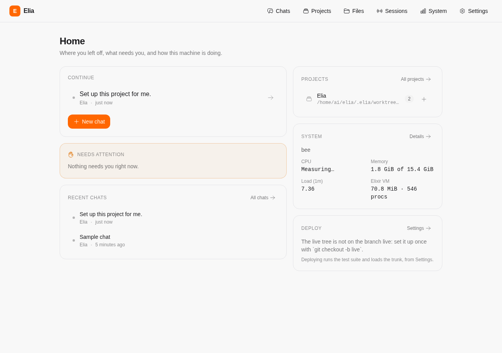
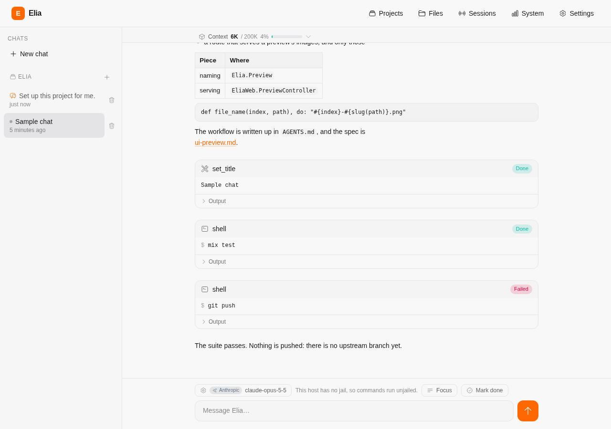
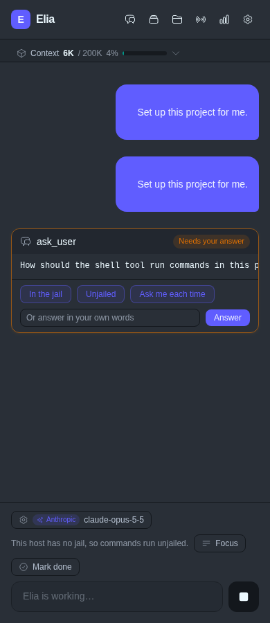
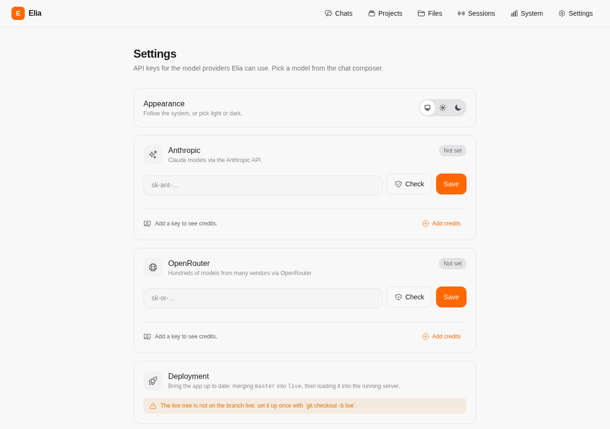

# Elia

A local AI harness with a chat UI (Phoenix LiveView). The agent works through
skills, can extend itself with new ones, and can change its own code behind
guardrails.

Elia is spec-driven: every feature has a spec in `specs/`, and the workflow and
index are in `specs/README.md`. The topic notes for editing the code are in
`docs/agents/`.

## Getting started

### What it needs

- **Elixir `~> 1.17`**, with a matching Erlang/OTP release
  (`elixir --version`; `erl` must be on `PATH` too). A distribution's `elixir`
  package is often older than 1.17, so `asdf` or `mise`, with the `erlang` and
  `elixir` plugins, is the reliable way to install both.
- **`git`** — a chat in Elia's own project works in its own git worktree, and a
  deploy fast-forwards a branch (DEPLOY-1, DEPLOY-5).
- **`bubblewrap`** (`bwrap`) — optional. Every OS command Elia runs is jailed;
  without bubblewrap, or where user namespaces or their mounts are unavailable,
  commands run unjailed instead, which the chat's settings page says (ISOL-12).
- **Node ≥ 20** — optional, and only for the real-browser tests and
  `bin/preview`, which install the browser layer's packages in `assets/`
  (BROWSER-10, PREVIEW-14).

Nothing else: no database, no Ecto, no Docker, and no API key needed to start.

### Set it up

```sh
git clone <the repository> elia
cd elia
mix setup                    # deps, the tailwind/esbuild binaries, the assets
mix phx.server               # http://localhost:7000
```

Then add a provider key, in the browser: open <http://localhost:7000>, go to the
Settings page (`/settings`) and paste an Anthropic or OpenRouter key into its
card. The key is checked against the provider before it is stored, so a bad key
fails there rather than in the middle of a chat (CONF-6, CONF-7); the same page
selects the model. Keys are user settings, not workspace data: they live in
`~/.local/share/elia/settings.dets`, outside the repository (CONF-1, CONF-4).
Setting `ANTHROPIC_API_KEY` or `OPENROUTER_API_KEY` in the environment works
too, and a key saved in Settings wins over one from there (CONF-5).

For chats to work in their own worktrees and for the Settings page to be able
to deploy, the tree the server runs from must be *set up for deployment*: on the
branch `live`, with a `master` at or ahead of it (DEPLOY-14). In a fresh clone,
from the trunk:

```sh
git checkout -b live         # the tree the server runs from; a deploy fast-forwards it
```

(`git branch master` once, at `live`, if the trunk has another name.) Until the
tree is set up, the Settings page says what is missing and a chat here edits the
live tree itself rather than a worktree (DEPLOY-1).

### Keep it running

`mix phx.server` stops when its terminal does. Either:

```sh
bin/serve                    # the server in a loop, restarted whenever it dies
bin/install-service --now    # a systemd user service: at login, restarts on failure
```

`bin/serve` starts the server again after a crash — waiting longer after each
quick failure, and turning off Erlang crash dumps so a crash loop can't fill the
disk (RESTART-1–RESTART-6). Ctrl-C stops it for good; an exit status of 0 means
it stays down (RESTART-2, RESTART-3).

`bin/install-service` renders `deploy/elia.service` with this project's root and
your `PATH` into `~/.config/systemd/user/elia.service`, then enables it. Stop a
server already running on port 7000 first. Afterwards:

```sh
systemctl --user start elia      # also: stop, restart, status, disable
journalctl --user -u elia -f     # the logs
loginctl enable-linger $USER     # start at boot, without a login
```

The unit reads `~/.config/elia/env` if it exists, as `KEY=value` lines — useful
for `PORT=...`, or for a provider key if you would rather keep it out of the
settings database (CONF-5). Don't put `MIX_ENV` in it: the server runs in Mix's
default `dev` env either way, and every command it spawns would inherit the
value (RESTART-8, ISOL-24).

`bin/serve` runs without an interactive shell; attach one with
`iex --sname dbg --remsh elia`. Without systemd, any supervisor will do, with
`bin/serve` as its command (`specs/auto-restart.md`).

A change to `lib/`, `config/` or `mix.exs` reaches the running app only through
a *deploy*, from the Settings page — a request recompiles and loads nothing
(DEPLOY-8). See Guardrails below.

## Pages

| Route | Page |
| --- | --- |
| `/` | Dashboard: what needs you, where you left off, recent chats, projects, the machine and the deploy state |
| `/chats`, `/c/:id` | The chat: transcript, Markdown, streaming, approvals; `/c/:id/settings` is its own settings page |
| `/projects` | Project folders a chat can work in |
| `/files` | Read-only workspace browser with a plain-text file viewer |
| `/logs` | The server's recent logs, captured in memory |
| `/system` | CPU, memory, disks, network, load and VM stats |
| `/sessions` | Open tabs, with IP, browser and page |
| `/settings` | API keys, the selected model, and the deploy buttons |

## Screenshots

Taken from the app itself with `bin/preview` (`specs/ui-preview.md`), on the
sample data a preview seeds: the dark theme at a phone width
(`ELIA_PREVIEW_THEME=dark`, `ELIA_PREVIEW_WIDTH=390`).



*The dashboard: what needs you, where you left off, the machine and the deploy
state.*



*A chat: a reply with Markdown, a reasoning block, tool calls with their output,
and one that failed.*



*`ask_user` puts a question to the user and the turn waits: each option is a
button, and there is always a field for an answer in their own words (ASK-4).*



*`/settings`: a card per provider for its API key, and the deploy buttons.*

## Tests and previews

```sh
mix precommit                    # compile (warnings as errors), format, test
mix test test/path_test.exs      # one file; --failed, --stale, --trace also work
mix assets.build && ELIA_BROWSER_TESTS=1 mix test --only real_browser
ELIA_PREVIEW_THEME=dark ELIA_PREVIEW_WIDTH=390 bin/preview @chat
```

The real-browser tests are excluded from a plain `mix test` so `run_tests` and
`mix precommit` stay fast and need no Node (BROWSER, `specs/browser-tests.md`).
`bin/preview` screenshots the workspace's own code in a real headless browser,
in the test env — no deploy, no API key — and prints a Markdown image link per
page (PREVIEW-9, `specs/ui-preview.md`).

## Layout

| Module | Role |
| --- | --- |
| `Elia.LLM` / `Elia.LLM.Provider` | Provider-neutral model calls; `Elia.LLM.Anthropic` is the default backend |
| `Elia.Agent` / `Elia.Agent.Session` / `Elia.Agent.Loop` | One process per chat; the tool-use loop with approvals |
| `Elia.Skill` / `Elia.Tool` | What a skill and a callable tool are |
| `Elia.Skills` | Registry of built-in and folder skills, reloadable at runtime |
| `Elia.Skills.{Shell,Files,Harness,Tasks,Titles,Done,UserInput,SelfModification}` | The built-in skills |
| `Elia.Skills.Folder` | Folder skills: `SKILL.md` and script-backed tools |
| `Elia.Tasks` | Lock and spawn/await for sub-task chats (`spawn_task`, `finish_task`) |
| `Elia.Harness` | Running the test suite (`run_tests`) |
| `Elia.Deploy` | Chat worktrees, the trunk `master` and `live`, deploying (hot reload or restart) |
| `Elia.Deps` | The dependency layer a chat's worktree compiles against |
| `Elia.Projects` | Project folders; every chat belongs to one and works in it (its worktree for Elia's own project) |
| `Elia.Workspace` | The workspace root and the path classes of the policy (WS) |
| `Elia.Shell` / `Elia.Priority` | Running OS commands, jailed and below the server's own priority |
| `Elia.Limits` | Per-chat turn limits: steps, wall-clock time and tokens |
| `Elia.Store` | Saved conversations in `.elia/sessions/` |
| `Elia.Settings` | API keys and the selected model, in a DETS file outside the workspace |
| `Elia.Logs` / `Elia.SystemStats` / `Elia.Explorer` | The `/logs`, `/system` and `/files` pages |
| `Elia.Preview` | What a UI preview names, seeds and serves (`bin/preview`) |

## Folder skills

Drop a folder in `skills/` (the agent can do this itself) and call
`reload_skills`:

```
skills/git-summary/
  SKILL.md       # ---\nname: git-summary\ndescription: ...\n---\nInstructions
  tools.json     # optional script-backed tools
  summary.sh
```

See `Elia.Skills.Folder` for the `tools.json` format. Tool input arrives in
`$ELIA_INPUT` (JSON) and `$ELIA_ARG_<FIELD>`, never spliced into the command.

## Guardrails

- **Approval**: shell commands, script tools and writes outside `skills/` need
  the user's approval. Writes under `skills/` don't. `.git`,
  `_build`, `deps` and `.elia` can't be written by the file tools, and paths
  outside the workspace are refused. With the jail on — the default — the file
  tools reach the workspace and nothing else: reading outside it is refused too,
  and so is a path that resolves through a symlink out of it, so they reach no
  further than a jailed command does (FILE-12, FILE-13).
- **Tests**: nothing runs the test suite for you at the end of a turn. The agent
  runs `run_tests` (or plain `mix precommit`: no command inherits the server's
  `MIX_ENV`, so the alias's `preferred_envs` picks `test`, ISOL-24) itself before
  finishing a change, and a deploy runs the full suite in the live tree before
  loading anything.
- **Deploying**: the server runs from the *live tree*; a chat in Elia's own
  project works in its own git worktree (branch `chat/<chat id>`, forked from
  the trunk `master`), so an in-progress edit can't reach the running app. When a
  change is done the agent merges its branch into `master` itself (fast-forward
  only); the user then deploys from the Settings page, which brings `master` to
  `live` and loads it — by "Hot reload" (the test suite first, then a recompile
  and reload, keeping running state) or by "Restart", which restarts the server
  in a clean process. A request never reloads code (`Elia.Deploy`).
- **Recovery**: there is no recovery page or checkpoint to roll back to; a chat's
  work is on its own branch, and a deploy refuses to load a tree whose suite or
  compile fails (DEPLOY-5, HOT-4).

The shell tool can do anything you approve, including bypassing these
policies, so read commands before approving them.
