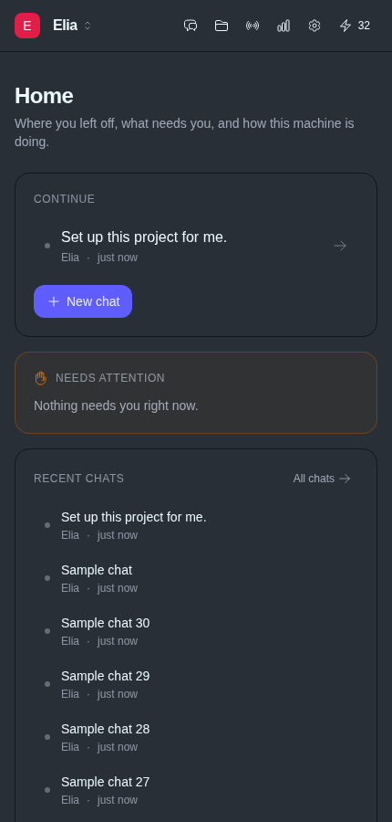
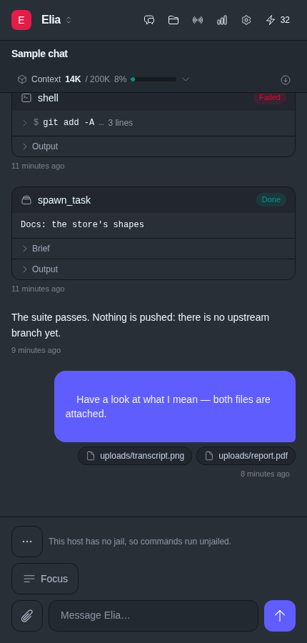
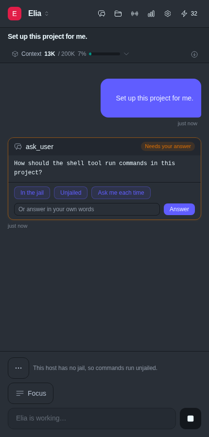
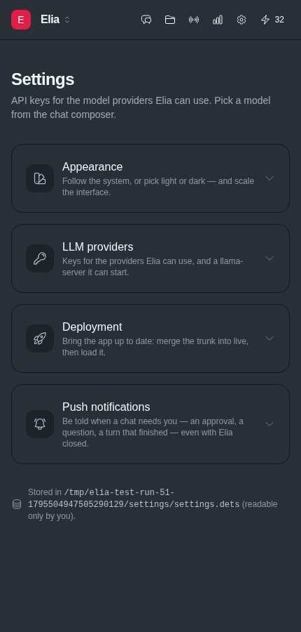

# Elia

A local AI harness with a chat UI (Phoenix LiveView). The agent works through
skills, can extend itself with new ones, and can change its own code behind
guardrails.

Elia is spec-driven: every feature has a spec in `specs/`, and the workflow and
index are in [`specs/README.md`](specs/README.md). The topic notes for editing
the code are in `docs/agents/` — [`harness.md`](docs/agents/harness.md),
[`elixir.md`](docs/agents/elixir.md),
[`phoenix-liveview.md`](docs/agents/phoenix-liveview.md),
[`frontend.md`](docs/agents/frontend.md) and
[`testing.md`](docs/agents/testing.md).

## Getting started

### What it needs

- **Elixir `~> 1.17`**, with a matching Erlang/OTP release
  (`elixir --version`; `erl` must be on `PATH` too). A distribution's `elixir`
  package is often older than 1.17, so `asdf` or `mise`, with the `erlang` and
  `elixir` plugins, is the reliable way to install both.
- **`git`** — a chat in Elia's own project makes itself a git worktree for a
  code change, and a deploy fast-forwards a branch (DEPLOY-28, DEPLOY-5).
- **`bubblewrap`** (`bwrap`) — optional. Every OS command Elia runs is jailed;
  without bubblewrap, or where user namespaces or their mounts are unavailable,
  commands run unjailed instead, which the chat's settings page says (ISOL-12).
- **Node ≥ 20** — needed to fill `assets/node_modules`, which the bundle and the
  stylesheet import and Git ignores: only an `npm install` in `assets/` fills
  it. Without Node, or without that install, Elia still compiles and still
  serves, and a browser gets no stylesheet and no JavaScript — there is no
  `/assets/js/app.js` or `/assets/css/app.css` to fetch (DEPLOY-34, DEPLOY-35).
  `bin/preview` needs Node too and installs the workspace's own packages for
  itself (PREVIEW-14).
- **A user-wide Playwright CLI** — optional, for the real-browser tests only:
  `npm install -g --prefix ~/.local playwright@1.64.1` puts it at
  `~/.local/lib/node_modules/playwright` for every project on the machine
  (BROWSER-2). A browser run that can't find it says so and names that command
  instead of failing inside the driver (BROWSER-10); the tests install nothing
  themselves.
- **`tmux`** — optional. A chat's terminal is a tmux session, and where tmux is
  not installed the terminal is unavailable and says so (TERM-29).

Nothing else: no database, no Ecto, no Docker, and no API key needed to start.

### Set it up

```sh
git clone <the repository> elia
cd elia
npm install --prefix assets  # the front end's Node packages (DEPLOY-34)
mix setup                    # deps, the tailwind/esbuild binaries, the assets
mix phx.server               # http://localhost:7000
```

`npm install` is the step that fills `assets/node_modules`, which Git ignores:
skip it and the last step of `mix setup` builds what it can without those
packages, so the app runs but a browser gets no stylesheet and no JavaScript
(DEPLOY-35).

Then add a provider key, in the browser: open <http://localhost:7000>, go to the
Settings page (`/settings`) and paste an Anthropic or OpenRouter key into its
card, or point its local model server at a `llama-server` and a `.gguf`, which
needs no key at all (LOCAL-1, LOCAL-2). The key is checked against the provider
before it is stored, so a bad key fails there rather than in the middle of a
chat (CONF-6, CONF-7). The model is picked in the chat itself, on its own
settings page (`/c/:id/settings`, MODEL-9, CSET-5). Keys are user settings,
not workspace data: they live in `~/.local/share/elia/settings.dets`, outside
the repository (CONF-1, CONF-4). Setting `ANTHROPIC_API_KEY` or
`OPENROUTER_API_KEY` in the environment works too, and a key saved in Settings
wins over one from there (CONF-5).

For the Settings page to be able to deploy, and for a chat in Elia's own
project to be able to make itself a worktree and merge it back, the tree the
server runs from must be *set up for deployment*: on the
branch `live`, with a `master` at or ahead of it (DEPLOY-14). In a fresh clone,
from the trunk:

```sh
git checkout -b live         # the tree the server runs from; a deploy fast-forwards it
```

(`git branch master` once, at `live`, if the trunk has another name.) Until the
tree is set up, the Settings page says what is missing; a chat here still works
in the live tree, but it can't push its worktree's branch to a `master` that is
checked out there, so it says so and asks (DEPLOY-1, DEPLOY-30).

### Keep it running

`mix phx.server` stops when its terminal does. Either:

```sh
bin/serve                    # the server in a loop, restarted whenever it dies
bin/install-service --now    # a systemd user service: at login, restarts on failure
```

`bin/serve` starts the server again after a crash — waiting longer after each
quick failure, and turning off Erlang crash dumps so a crash loop can't fill the
disk (RESTART-1–RESTART-6). Ctrl-C stops it for good; an exit status of 0 means
it stays down (RESTART-2, RESTART-3).

`bin/install-service` renders `deploy/elia.service` with this project's root and
your `PATH` into `~/.config/systemd/user/elia.service`, then enables it. Stop a
server already running on port 7000 first. Afterwards:

```sh
systemctl --user start elia      # also: stop, restart, status, disable
journalctl --user -u elia -f     # the logs
loginctl enable-linger $USER     # start at boot, without a login
```

The unit reads `~/.config/elia/env` if it exists, as `KEY=value` lines — useful
for `PORT=...`, or for a provider key if you would rather keep it out of the
settings database (CONF-5). Don't put `MIX_ENV` in it: the server runs in Mix's
default `dev` env either way, and every command it spawns would inherit the
value (RESTART-8, ISOL-24).

Behind a proxy that terminates TLS or rewrites the hostname,
`ELIA_ALLOWED_ORIGINS` belongs there too: the origins the app is reached at,
comma-separated, each an origin (`https://elia.example.com:8443`), a host
(`//elia.example.com:8443`) or a host with a wildcard (`//*.example.com`). Elia
has no authentication, so a socket handshake is bound to the *page* it came from
— its `Origin` must name the host, scheme and port the handshake itself arrived
at (SOCK-1) — and naming origins puts your list in place of that binding, which
is what an install served from somewhere else needs (SOCK-4). Unset is the
ordinary install, and then the host binding is the whole policy: a page loaded
from this server connects with nothing to configure. It is read at boot, so a
change to it needs a restart rather than a hot reload.

`ELIA_PREVIEW_HOST` is the other optional knob. Set it to a hostname and the
app serves a project's files over HTTP at that host, so a browser runs what the
project builds while none of the app's own routes answer there; unset, nothing
is served as a preview (SERVE-1, SERVE-2). It is read at boot too.

`bin/serve` runs without an interactive shell; attach one with
`iex --sname dbg --remsh elia`. Without systemd, any supervisor will do, with
`bin/serve` as its command ([`specs/auto-restart.md`](specs/auto-restart.md)).

A supervisor is also what makes the Settings page's *Restart* deploy available:
`bin/serve` exports `ELIA_SUPERVISED=1` to the server it runs, and the app asks
for that marker, because only a server something outside the VM would bring back
can be restarted (DEPLOY-33, RESTART-12). A manager that starts the app itself —
`mix phx.server`, not `bin/serve` — has to export `ELIA_SUPERVISED=1` too;
without it the page offers hot reload only, and the disabled control says why.

A change to `lib/`, `config/` or `mix.exs` reaches the running app only through
a *deploy*, from the Settings page — a request recompiles and loads nothing
(DEPLOY-8). See Guardrails below.

A deploy runs the full suite first — unless it is asked to leave the suite out
(DEPLOY-40) — but that suite is LiveView-level in any case (the browser tests
are excluded, BROWSER-5), so a broken layout, a hook that raises
on mount or a new class with no rule can pass it and still leave the UI
unusable — the Settings page included. `/recover` is the way back from that:
plain, server-rendered HTML that needs none of the tree's front end (no
stylesheet, no JavaScript, no LiveView socket), served by a plug before the
router, saying what the app is on and which revisions it has run, and putting it
back on one of them (RECOVER-10 to RECOVER-15, DEPLOY-25, DEPLOY-26). The
deployment section of the Settings page names its address too (RECOVER-15).

## Pages

| Route | Page |
| --- | --- |
| `/` | Dashboard: what needs you, where you left off, recent chats, projects, the machine and the deploy state |
| `/chats` | The chat list's entry point: it resumes the most recent chat, or starts one (UI-77) |
| `/c/:id` | The chat: transcript, Markdown, streaming, approvals |
| `/c/:id/settings` | This chat's own settings page: the model picker, auto-approval, jail, network, limits and context (CSET-5) |
| `/c/:id/terminal` | This chat's terminal (TERM-19) |
| `/p/:project_id/new` | A new chat in a project |
| `/projects` | Project folders a chat can work in |
| `/files` | Read-only workspace browser with a plain-text file viewer, and a raw mode that shows a file as the browser renders it (EXPL-24) |
| `/logs` | The server's recent logs, captured in memory |
| `/system` | CPU, memory, disks, network, load and VM stats |
| `/sessions` | Open tabs, with IP, browser and page |
| `/settings` | Appearance, the provider keys (and a local llama-server), the deploy section and push notifications |
| `/recover` | Plain HTML that reaches the app when its own UI is broken: what it is on, the revisions it has run, and a button that sends it back to one |

## Screenshots

Taken from the app itself with `bin/preview`
([`specs/ui-preview.md`](specs/ui-preview.md)), on the sample data a preview
seeds: the dark theme at a phone width (`ELIA_PREVIEW_THEME=dark`,
`ELIA_PREVIEW_WIDTH=390`).



*The dashboard: what needs you, where you left off, the machine and the deploy
state.*



*A chat: a reply with Markdown and a code block, file links, tool calls with
their output, one that failed, and the composer's chat menu showing the model
(CSET-8).*



*`ask_user` puts a question to the user and the turn waits: each option is a
button, and there is always a field for an answer in their own words (ASK-4).*



*`/settings`: a card per provider for its API key. The deploy section and push
notifications follow below.*

## Tests and previews

```sh
mix precommit                    # compile (warnings as errors), format, then `bin/test`
mix test test/path_test.exs      # one file; --failed, --stale, --trace also work
bin/test                         # the whole suite as concurrent partitions (SUITE-1)
bin/test --plan                  # how it would split, without running it
mix assets.build && ELIA_BROWSER_TESTS=1 mix test --only real_browser
ELIA_PREVIEW_THEME=dark ELIA_PREVIEW_WIDTH=430 bin/preview @chat
```

The real-browser tests are excluded from a plain `mix test`, so `mix test` and
`mix precommit` stay fast and need no browser and no Node (BROWSER-5,
[`specs/browser-tests.md`](specs/browser-tests.md)). Run on their own they need
built assets and the user-wide Playwright CLI listed under "What it needs"
(BROWSER-2, BROWSER-6).
`bin/preview` screenshots the workspace's own code in a real headless browser,
in the test env — no deploy, no API key — and prints a Markdown image link per
page (PREVIEW-5, [`specs/ui-preview.md`](specs/ui-preview.md)).

## Layout

The parts and how a message travels through them are drawn in [`docs/architecture.md`](docs/architecture.md); this table is the module-level view.

| Module | Role |
| --- | --- |
| `Elia.LLM` / `Elia.LLM.Provider` | Provider-neutral model calls; `Elia.LLM.Anthropic` is the default backend |
| `Elia.Agent` / `Elia.Agent.Session` / `Elia.Agent.Loop` | One process per chat; the tool-use loop with approvals |
| `Elia.Skill` / `Elia.Tool` | What a skill and a callable tool are |
| `Elia.Skills` | Registry of built-in and folder skills, reloadable at runtime |
| `Elia.Skills.{Shell,Workdir,Terminal,Harness,Tasks,Titles,Done,Chats,UserInput,Network,Image}` | The built-in skills |
| `Elia.Skills.Folder` | Folder skills: `SKILL.md` and script-backed tools |
| `Elia.Harness` | Running the test suite (`Elia.Harness.run_tests/3`, the deploy's gate; a chat runs it with the `shell` tool) |
| `Elia.Deploy` | The trunk `master` and `live`, deploying (hot reload or restart), and the tree a chat's workspace resolves to |
| `Elia.Projects` | Project folders; every chat belongs to one and works in it (the live tree for Elia's own project) |
| `Elia.Workspace` | The workspace root and the path classes of the policy (WS) |
| `Elia.Workdir` | A chat's working directory: what a relative path in a `shell` command resolves against (WD) |
| `Elia.Shell` / `Elia.Priority` | Running OS commands, jailed and below the server's own priority |
| `Elia.Net` | A chat's network setting: what its commands and its terminal may reach (NET) |
| `Elia.Snapshot` | The git snapshot bracketing a `shell` call, and the diff a chat shows of it (SNAP) |
| `Elia.Terminal` | A chat's terminal: one jailed, niced tmux session in its workspace (TERM) |
| `Elia.Limits` | Per-chat turn limits: steps, wall-clock time and tokens |
| `Elia.StepTiming` | Each loop step's stamps, durations and usage (TIME) |
| `Elia.Store` / `Elia.Store.Index` | Saved conversations in `.elia/sessions/`, and the index in memory over them that a search reads (SEARCH) |
| `Elia.Uploads` | The files a message carries, written into the chat's workspace (UPLOAD) |
| `Elia.Settings` | API keys, the last model selection as the default (MODEL-15) and the other user settings, in a DETS file outside the workspace |
| `Elia.Logs` / `Elia.SystemStats` / `Elia.Explorer` | The `/logs`, `/system` and `/files` pages |
| `Elia.Push` | Web Push: a chat that needs the user notifies their device (PUSH) |
| `Elia.Source` / `Elia.Specs` | The function definitions a workspace's source holds, and the spec corpus it holds (FUNC, CITE) |
| `Elia.Preview` | What a UI preview names, seeds and serves (`bin/preview`) |

## Folder skills

Drop a folder in `skills/` (the agent can do this itself) and call
`reload_skills`:

```
skills/git-summary/
  SKILL.md       # ---\nname: git-summary\ndescription: ...\n---\nInstructions
  tools.json     # optional script-backed tools
  summary.sh
```

See `Elia.Skills.Folder` for the `tools.json` format. Tool input arrives in
`$ELIA_INPUT` (JSON) and `$ELIA_ARG_<FIELD>`, never spliced into the command.

## Guardrails

- **Approval**: shell commands, script tools and starting a terminal session
  need the user's approval (TERM-10). A file is read, searched, created, edited
  and deleted by a command, not by a tool of its own (SHELL-15), so what stands
  behind a file change is that approval and the jail: with the jail on — the
  default — a command reaches its workspace and the toolchain and nothing else,
  so a path outside it, or one that resolves through a symlink out of it, is
  beyond reach (ISOL-13). A jailed command can still write its workspace's
  `.git` and `_build`, which the retired file tools refused (FILE).
- **Tests**: nothing runs the test suite for you at the end of a turn. The agent
  runs the tests itself — `mix test`, or plain `mix precommit` (no command
  inherits the server's `MIX_ENV`, so the alias's `preferred_envs` picks `test`,
  ISOL-24) — before finishing a change, and a deploy runs the full suite in the
  live tree before loading anything.
- **Deploying**: the server runs from the *live tree*; a chat in Elia's own
  project does the work for a change in a git worktree it makes inside that tree
  (branch `chat/<chat id>`, forked from the trunk `master`, DEPLOY-28), so an
  in-progress edit needn't reach the running app. When a change is done the
  agent merges its branch into `master` itself (fast-forward only); the user
  then deploys from the Settings page, which brings `master` to `live` and
  loads it — by "Hot reload" (the test suite first, then a recompile and
  reload, keeping running state) or by "Restart", which restarts the server in
  a clean process, and the same section can push the trunk to the tree's
  `origin` (`git push origin master`, DEPLOY-41). A request never reloads code
  (`Elia.Deploy`).
- **Recovery**: a chat's work is on its own branch, and a deploy refuses to load
  a tree whose suite or compile fails (DEPLOY-5, HOT-4), so a bad change can't
  reach the running app. There is no checkpoint to roll back to, but `/recover`
  covers the failure that gate does not catch — a deploy that passes its suite
  and still leaves the UI unusable: plain HTML with no bundle and no JavaScript,
  putting the app back on a revision it has run before (RECOVER-10 to
  RECOVER-15, [`specs/recovery.md`](specs/recovery.md)).

The shell tool can do anything you approve, including bypassing these
policies, so read commands before approving them.
