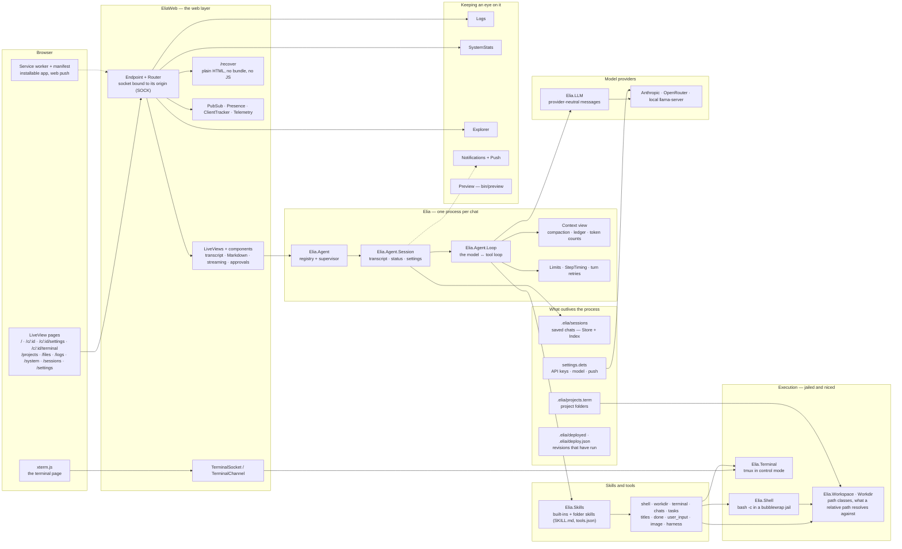
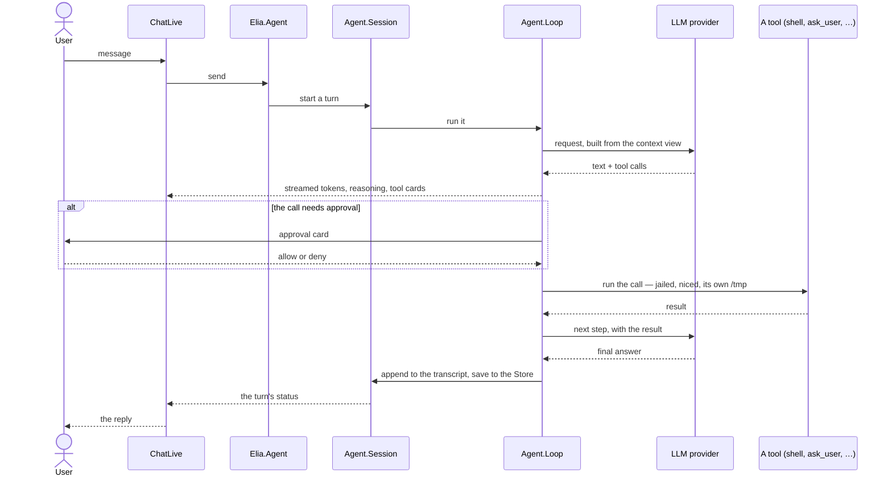
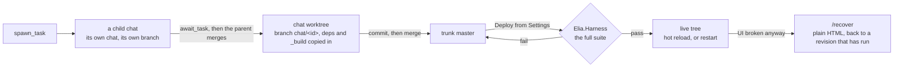

# Architecture

Elia is a local AI harness: a Phoenix LiveView chat UI over an agent that works
through skills and can change its own code behind guardrails. This page maps the
parts and how a message travels through them.

It is orientation, not a contract. What each part must do is specified in
`specs/` (the index is `specs/README.md`), and `README.md`'s Layout table lists
the module roles. Where the two disagree with this page, they win.

## The parts



The parts are layered rather than a service split: one OTP application
(`Elia.Application`) starts them in order — the store's cache and the search
index first, then the chat registry and its supervisor, then the settings, the
skills registry, the deploy runner and the endpoint last.

- **A chat is a process.** `Elia.Agent` starts and finds one per conversation;
  `Elia.Agent.Session` holds its transcript, status and settings, and
  `Elia.Agent.Loop` runs one turn. The transcript the user sees is the whole
  record; what the model is sent is a derived *context view*, so compaction
  never rewrites the visible history.
- **Skills are how the agent acts.** `Elia.Skills` holds the built-ins plus any
  folder skills (`skills/<name>/SKILL.md`, optionally with script-backed tools),
  reloadable at runtime, and a project can add its own.
- **Every OS command goes through one door.** `Elia.Shell` runs it in a
  bubblewrap jail at a lower CPU and I/O priority than the server; the workspace
  policy decides what a path may reach. A chat's terminal is the same idea for a
  program that has to keep running.
- **Nothing durable is in a database.** Saved chats are files under
  `.elia/sessions/`, projects are `.elia/projects.term`, and user settings (API
  keys, the selected model) are a DETS file outside the workspace.
- **The observation pages are read-only windows**: logs captured in memory,
  system stats, the workspace browser, the notification list, and the UI preview.

## One turn of a chat



The loop is a model ↔ tool cycle with gates in it: a tool call that needs the
user's approval pauses the turn, `ask_user` waits for an answer, a limit pauses
or stops the turn, and a transient provider error is retried rather than failing
it. A turn that ends without the model finishing writes why into the transcript.
A restart during a turn leaves a record the next boot resumes from, once.

## A change, from worktree to live



The guardrails are in this picture:

- A chat in Elia's own project works in a **git worktree of its own** and merges
  its branch into `master` itself; nothing edits the live tree under a running
  server, and the harness never merges for the agent.
- A **deploy** is the user's step, from the Settings page: it brings `master` to
  `live`, runs the full suite first, and then either reloads the code in the
  running server or restarts it. A request never reloads code.
- A sub-task is an **ordinary chat** that ends by being marked done; its work
  stops at its own branch, and the parent merges it when it wants the work.
- `/recover` covers what the gate cannot: a deploy that passes its suite and
  still leaves the UI unusable. It is plain server-rendered HTML, so it needs
  none of the tree's own front end.

## Rendering these diagrams

GitHub, most editors and a docs site render a `mermaid` block themselves. To
render one locally, and to check a diagram still parses, mermaid-cli works with
the Chromium this machine already has:

```sh
mkdir -p tmp/mmd && npm install --prefix tmp/mmd @mermaid-js/mermaid-cli
printf '{"args":["--no-sandbox"]}\n' > tmp/mmd/pptr.json
PUPPETEER_SKIP_DOWNLOAD=true PUPPETEER_EXECUTABLE_PATH=/usr/bin/chromium \
  tmp/mmd/node_modules/.bin/mmdc -p tmp/mmd/pptr.json \
    -i docs/architecture.md -o tmp/mmd/rendered.md
```

A Markdown file as `-i` renders every block in it and reports each one; for a
PNG, give a single `.mmd` file and `-o out.png -s 2`. It is `-s/--scale` and
`--size` in mermaid-cli 12 — `-w` and `--width` are not options there.
