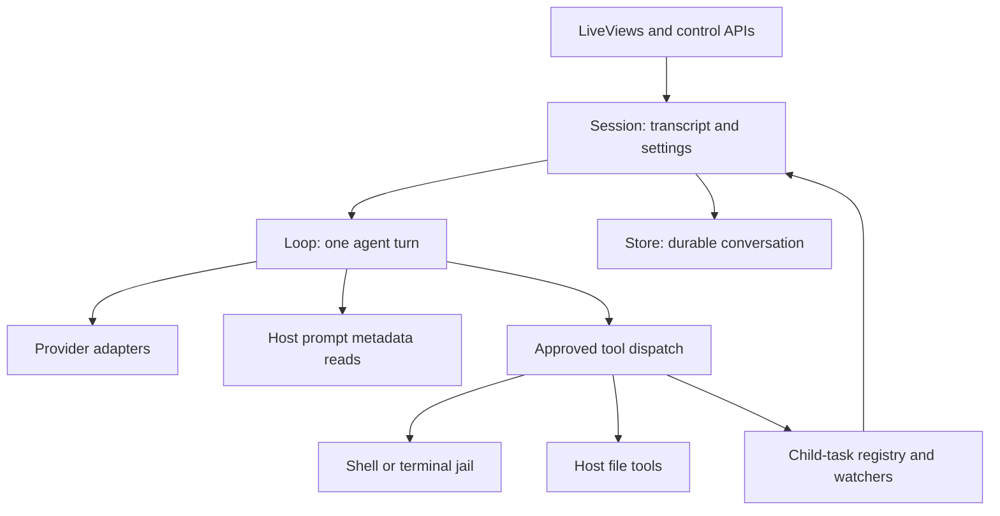

# Architecture and ownership map

[Start](../README.md) · [Summary](../SUMMARY.md) · [AI routes](../ai/ROUTING-INDEX.md)

This is an orientation map of the reviewed snapshot, not a replacement specification. The repository's current owning specs remain the behavior contract. Findings describe places where observed implementation does not satisfy that intent or where a boundary needs an explicit requirement.

## Runtime flow

The branches matter: a bubblewrap mount policy governs OS commands, while BEAM `File.*` operations execute in the host process. Prompt metadata is read while the loop constructs its provider request, before tool approval. A correct jail does not automatically constrain that read or file-tool writes. Likewise, the session-to-loop edge needs a lifetime rule, not only a task handle. These are the boundaries behind SEC-01/02 and CORE-02. [Security](SECURITY.md), [Core](CORE.md).

### Module entry points

| Area | Start with | Responsibility |
| --- | --- | --- |
| Application lifetime | `lib/elia/application.ex` | Ordered children, registries, dynamic/task supervisors, store cache, terminal, deploy runner and boot resumer |
| Session API | `lib/elia/agent.ex` | Start/find session, snapshot, send, approve/deny, stop/resume, settings |
| Session state | `lib/elia/agent/session.ex` | Full history, status, persistence, compaction state and turn ownership |
| Turn execution | `lib/elia/agent/loop.ex` | Prompt/request view, model stream, approval/input gates, concurrent tools, limits and retry |
| Child work | `lib/elia/tasks.ex`, `lib/elia/skills/tasks.ex` | Workspace lock/identity, spawn/watch/await/result, child skill exposure |
| Provider protocol | `lib/elia/llm.ex`, `lib/elia/llm/*` | Neutral messages, provider conversion, catalog, stream parsing, compaction and estimates |
| Files/commands | `workspace.ex`, `shell.ex`, `skills/files.ex`, `skills/folder.ex` | Path classes, mounts, host operations and script launch |
| Deploy | `deploy.ex`, `deploy/runner.ex`, `harness.ex` | Live/trunk/worktrees, serialized deployment, test gate, bundle build, loaded revision |
| Web | `lib/elia_web/live/*`, router/endpoint, terminal socket/channel | UI control surface, transcript and stream display, terminal transport, recovery |

The [source ledger](../meta/source-ledger.json) and [inventory](../evidence/repository-inventory.json) provide pinned URLs for these paths. Primary orientation sources: [README layout](https://github.com/Tommos0/elia/blob/5be0bd873bd2716529de25541efb1825495cd12e/README.md#L146-L174), [application children](https://github.com/Tommos0/elia/blob/5be0bd873bd2716529de25541efb1825495cd12e/lib/elia/application.ex), [agent API](https://github.com/Tommos0/elia/blob/5be0bd873bd2716529de25541efb1825495cd12e/lib/elia/agent.ex).

## Do not collapse these identities

| Identity | Intended meaning | Common review trap |
| --- | --- | --- |
| Runtime/live root | Server checkout and `.elia` data location | Assuming a chat's writable root is the server checkout |
| Project folder | Registered external folder, or Elia's live folder for its own project | Treating a correct project label as proof of correct tool cwd |
| Chat workspace | An Elia chat worktree when configured; otherwise the project's working folder | Falling back to a global root without preserving external-project identity |
| Child workspace | Child's own Elia worktree, or shared external parent workspace | Assuming a child sees the parent's uncommitted changes |
| Skill directory | Where script-backed tools start | Using it as the complete confinement root and hiding the project |
| Readable mount | A path the jailed command may read | Treating readability as permission for a host-side mutation |

The code has explicit `root`, `runtime_root`, `project` and `workspace` concepts; future helpers should keep them explicit in APIs. `CORE-01` and `SEC-04` show the cost of reusing the wrong one. [Workspace definitions](https://github.com/Tommos0/elia/blob/5be0bd873bd2716529de25541efb1825495cd12e/lib/elia/workspace.ex#L28-L45), [project harness identity](https://github.com/Tommos0/elia/blob/5be0bd873bd2716529de25541efb1825495cd12e/lib/elia/projects.ex#L39-L52), [deployment workspaces](https://github.com/Tommos0/elia/blob/5be0bd873bd2716529de25541efb1825495cd12e/lib/elia/deploy.ex#L604-L709).

## Conversation and task states

The session's full transcript is the user-facing record. The provider receives a derived request view with compaction/pins/ledger, so changing what is sent must not silently rewrite what the user sees. A turn may run, await approval, await input, pause at a limit, stop, or finish. A chat's “done” flag and a subtask's final result are separate concepts. [SESS](https://github.com/Tommos0/elia/blob/5be0bd873bd2716529de25541efb1825495cd12e/specs/agent-sessions.md), [COMPACT](https://github.com/Tommos0/elia/blob/5be0bd873bd2716529de25541efb1825495cd12e/specs/compaction.md), [DONE](https://github.com/Tommos0/elia/blob/5be0bd873bd2716529de25541efb1825495cd12e/specs/chat-done.md).

In particular, stopping a child's turn deliberately leaves its task unfinished/running and its watcher waiting. A task marked running is therefore not proof that an OS process or model request is currently progressing. This is a stated product rule, not a bug to remove while fixing lifecycle cleanup. The parent decides how to integrate child commits; the harness does not automatically merge them. [SUBTASK-16/17 and concurrency](https://github.com/Tommos0/elia/blob/5be0bd873bd2716529de25541efb1825495cd12e/specs/subtasks.md), [current task skill](https://github.com/Tommos0/elia/blob/5be0bd873bd2716529de25541efb1825495cd12e/lib/elia/skills/tasks.ex).

## Persistent data map

| Data | Location/type | Review implication |
| --- | --- | --- |
| Conversations, settings attached to chats, task/turn metadata | `.elia/sessions/*.term`, through `Elia.Store` | Preserve older shapes and provider raw blocks; atomic replacement does not validate semantic shape |
| Projects | `.elia/projects.term` | A registered folder can later disappear; UI must tolerate it |
| User/API/model/push settings | `$XDG_DATA_HOME/elia/settings.dets`, defaulting under the user's local data directory | Outside checkout/rollback; read-modify-write still needs transaction ownership |
| Loaded revision and deployment history | `.elia/deployed`, `.elia/deploy.json` | Git HEAD, recorded loaded revision and served asset bytes are different facts |
| Chat worktrees/dependency layers | Under the live data/worktree infrastructure | Must preserve workspace ownership and avoid writes into shared lower layers |

Sources: [store](https://github.com/Tommos0/elia/blob/5be0bd873bd2716529de25541efb1825495cd12e/lib/elia/store.ex), [projects](https://github.com/Tommos0/elia/blob/5be0bd873bd2716529de25541efb1825495cd12e/lib/elia/projects.ex#L1-L27), [settings](https://github.com/Tommos0/elia/blob/5be0bd873bd2716529de25541efb1825495cd12e/lib/elia/settings.ex), [deployment records](https://github.com/Tommos0/elia/blob/5be0bd873bd2716529de25541efb1825495cd12e/lib/elia/deploy.ex#L168-L270), [dependency layers](https://github.com/Tommos0/elia/blob/5be0bd873bd2716529de25541efb1825495cd12e/lib/elia/deps.ex).

A repair should state exactly which of these it reads/writes and whether older values remain readable. “No database” does not mean “no schema or migration.” No real stored conversations, API keys or user settings were inspected in this review.

## Deployment is several different transitions

Source is committed on chat branches and integrated into `master`. The reviewed implementation moves `live` to the candidate, fetches dependencies and runs its test gate, builds assets, then loads or restarts it; it resets tracked source on failure. Some documentation describes testing before the fast-forward, so reason from the actual operation order when assessing filesystem effects. A Git fast-forward is not proof that the runtime loaded it. A successful build is not proof that an existing browser has a coherent new bundle. The runner already records several of these transitions; DEP-01 asks that asset promotion/restoration join the explicit transaction. [Deployment operation](https://github.com/Tommos0/elia/blob/5be0bd873bd2716529de25541efb1825495cd12e/lib/elia/deploy.ex#L1096-L1135), [runner](https://github.com/Tommos0/elia/blob/5be0bd873bd2716529de25541efb1825495cd12e/lib/elia/deploy/runner.ex).

## Where to simplify without a rewrite

Use small shared policy functions at host file-ingress/mutation boundaries; preserve the useful distinction between readable and writable targets. Give slow operations explicit lifetime/generation state. Resolve the workspace once and pass it through tools, locks and Git. Add a narrow atomic settings update API instead of replacing DETS wholesale. Build acceptance tests around observable invariants across components. These are review recommendations derived from the findings, not a proposal to add a database, split the application into services or rewrite LiveView.
